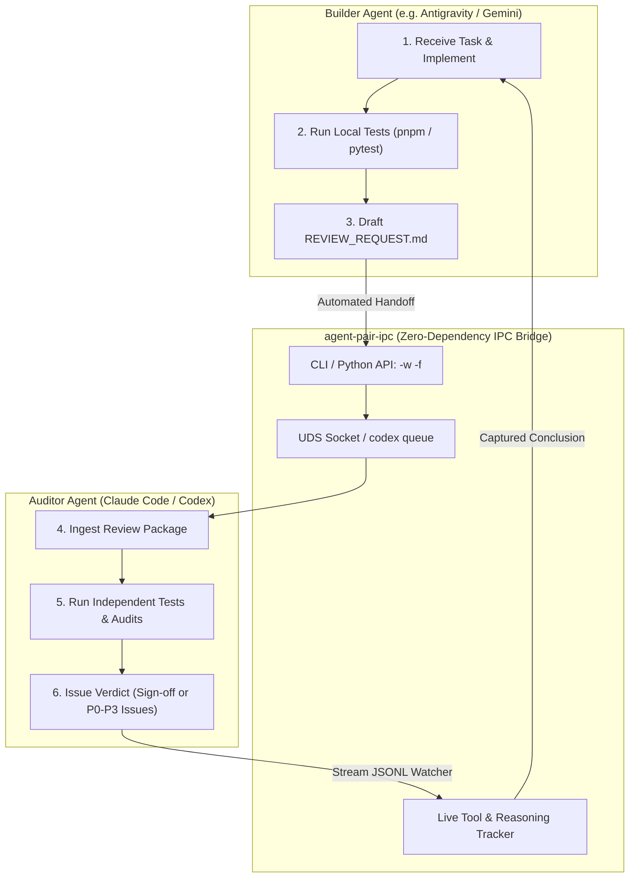

# agent-pair-ipc 🤖⚡🤖

> **Zero-dependency local IPC & automated pair-review toolkit for Claude Code, OpenAI Codex, and Google Antigravity.**

[](LICENSE)
[](https://www.python.org/downloads/)
[](pyproject.toml)
[](README_CN.md)

[**中文说明文档 (README_CN.md)**](README_CN.md) | [**实战 SOP 深度经验**](docs/pair_programming_sop.md)

---

## 💡 Why agent-pair-ipc?

When developing with AI coding assistants, two primary bottlenecks emerge:
1. **The "Confirmation Bias" Trap**: A single agent implementing and self-testing code easily suffers from hallucinations, skips edge cases, or subtly compromises architectural constraints.
2. **The "Copy-Paste Fatigue" Trap**: Developers constantly juggle chat windows, terminal CLIs, and browser tabs—manually copying errors, diffs, and prompts between different models.

**`agent-pair-ipc`** bridges local AI coding agents via native Inter-Process Communication (Unix Domain Sockets & local thread queues). One agent acts as the **Builder** (implementing code and running local gates) while another acts as the **Auditor** (independently re-verifying and auditing), with the human engineer presiding as the **Chief Judge**.



---

## ⚡ The Core Innovation: Living-Session Reuse

Most multi-agent frameworks spawn ephemeral, cold-started API instances that have no awareness of your active editor state, git worktrees, or recent debugging history.

**`agent-pair-ipc`** pairs directly with **living, interactive agent sessions**:
- **Full Historical Context**: Reuses the session that already loaded and reasoned through your codebase.
- **Human Supervision & Intervention**: You can visually observe, inspect, or interrupt the review process directly in your Claude Desktop tab or Codex CLI window.
- **Zero-Dependency Harness**: Uses Python standard library primitives to ensure rock-solid determinism for stochastic model outputs.

---

## ✨ Key Features

- 🪶 **Zero Third-Party Dependencies**: Pure Python 3.10+ standard library (`socket`, `json`, `subprocess`, `argparse`, `pathlib`). Works immediately on macOS without `pip install` bloat.
- 🔌 **Dual Engine Support**:
  - **Claude Code**: Interacts directly with CLI / Desktop sessions via Unix Domain Sockets (`AF_UNIX`) and tracks project JSONL transcripts.
  - **OpenAI Codex**: Injects messages via native `codex queue` and monitors rollout event streams (`Reasoning`, `custom_tool_call`, `task_complete`).
- 🎯 **Safe Multi-Project Routing & CWD Affinity**: Automatically identifies active sessions matching current project working directory (`cwd`) with strict dirty-binding invalidation and fallback. Explicit cross-project calls inject visible markdown context warnings into peer envelopes.
- 🔗 **Project Aliases & Symlink Awareness**: Supports multi-directory worktrees via `.agent-pair/config.json` (`"aliases": [...]`) and top-level directory symlinks with strict safety boundaries (ancestor relaxation restricted to verified `.git` / `.agent-pair` roots).
- 🛡️ **Path Guard & Ambiguity Defense**: Blocks accidental filesystem paths in `-s` with user-friendly diagnostics while allowing title names containing slashes (e.g. `"UI/UX 评审"`). Refuses to guess on ambiguous session names.
- 📁 **File-Based Payload Pipeline (`-f`, `-f -`)**: Files or quoted heredocs via stdin. Backticks and `$(...)` survive verbatim, and oversized Codex payloads are moved to 0600 files instead of argv.
- ↩️ **Duplex Reply Channel**: Every request carries a return address. The peer answers with `agent-pair-ipc reply --to <Req-ID>` over an ephemeral 0600 socket (with progress frames and acks). Late answers land in a mailbox (`agent-pair-ipc inbox`), and transcript tailing remains the fallback. See [docs/duplex_reply_protocol.md](docs/duplex_reply_protocol.md).
- 🖥️ **GUI-Native Session Pairing**: Without a session, `--await-new-session -g` opens a *visible* session through the desktop app's own New Session action, then auto-binds it. No invisible orphan processes.
- 🛡️ **Honest Peer Envelope**: Declares intent, operation boundary, and an unverified user-context quote, and states that a peer message is never user approval. This matches Claude Code's peer policy instead of tripping it.
- ⚡ **O(1) Incremental Tailing**: Employs file-offset incremental seeking, avoiding performance bottlenecks on large multi-megabyte session histories.
- 🔗 **Request-Response Correlation (Nonce)**: Generates unique correlation IDs for every request, ensuring zero race conditions even when sessions are handling multi-stage tasks.
- 🚦 **Machine-Readable Verdict Contract**: Built-in support for `VERDICT: SIGN_OFF` and `VERDICT: CHANGES_REQUESTED` mapped directly to CI-friendly exit codes.
- 🧩 **Native Skill Exports**: Ready-to-use Antigravity and Agent skill definitions under `skills/`.

---

> **⚠️ Disclaimer**: `agent-pair-ipc` is an independent, unofficial open-source developer tool. It is not affiliated with, sponsored by, or endorsed by Anthropic, OpenAI, or Google. It interacts with local process queues and socket interfaces which may change across upstream releases. Tested with Claude Code (2.1.x) and codex-cli (0.159.x).

---

## 🚀 Quick Start (60 Seconds)

### Option 1: Standalone (No Install Required)

```bash
git clone https://github.com/VeeDou/agent-pair-ipc.git
cd agent-pair-ipc

# List all active Claude Code and Codex sessions
./bin/agent-pair-ipc list

# Deliver review package and wait for conclusion
./bin/agent-pair-ipc claude -w -f ./templates/REVIEW_REQUEST.md
```

### Option 2: Install via pip

```bash
cd agent-pair-ipc
pip install -e .

# Direct CLI tools are now available system-wide:
agent-pair-ipc list
claude-ipc -w -f ./templates/REVIEW_REQUEST.md
codex-ipc -w -f ./templates/REVIEW_REQUEST.md
```

### Option 3: One engine for every workspace

```bash
make link-skills
```

This symlinks `~/.agents/skills/{claude-code-ipc,codex-ipc}` and `~/.gemini/config/skills/...` to this repo,
so every project uses the same engine. The skills' `scripts/*.py` paths keep working as thin shims.
Stale copies that are real directories are moved to `~/.agent-pair/backups/` first.

---

## 📖 CLI Cheat Sheet

### 1. Claude Code IPC (`claude-ipc` or `agent-pair-ipc claude`)

```bash
# Deliver file and wait for review completion (Most Common)
claude-ipc -w -f docs/reports/REVIEW_REQUEST.md

# Prepend a notice message before the file content
claude-ipc -w --prefix "【Phase 2 Complete】Please audit edge cases" -f docs/reports/REVIEW_REQUEST.md

# Read latest completed assistant verdict without sending a message
claude-ipc -r

# Rich markdown / code without shell escaping (quoted heredoc via stdin)
claude-ipc -w -f - <<'AP_EOF'
Check `rules/proxy.yaml`: AND,((DST-PORT,443),(NETWORK,UDP)),REJECT
AP_EOF

# No session yet: open one in Claude Desktop (File > New Session), auto-bind, deliver
claude-ipc --await-new-session -g -w -f docs/reports/REVIEW_REQUEST.md

# Fire-and-forget async notification
claude-ipc --intent Notification -m "Background test suite triggered."

# List connectable Claude Code sessions
claude-ipc -l
```

### 2. OpenAI Codex IPC (`codex-ipc` or `agent-pair-ipc codex`)

```bash
# Deliver report and wait for Codex sign-off
codex-ipc -w -f docs/reports/REVIEW_REQUEST.md

# Send message and synchronously wait for response
codex-ipc -w -m "Gate tests passed. Please sign-off."

# Read latest feedback from specific session ID
codex-ipc -r -s 01234567-89ab-cdef-0123-456789abcdef

# List recent Codex sessions
codex-ipc -l
```

### 3. Duplex replies (`agent-pair-ipc reply` / `inbox`)

```bash
# Receiver side: answer the request (the exact command is printed in the envelope)
agent-pair-ipc reply --to req_8f3e2a0c1b2d -f - <<'AP_REPLY_EOF'
Found one issue in `rules.yaml` ...
VERDICT: CHANGES_REQUESTED
AP_REPLY_EOF

# Requester side: collect answers that arrived after waiting ended
agent-pair-ipc inbox
agent-pair-ipc inbox req_8f3e2a0c1b2d
```

---

## 🐍 Python API Usage

You can embed `agent-pair-ipc` directly into your custom CI runners or pre-commit hooks:

```python
from agent_pair_ipc import send_and_wait_claude, send_and_wait_codex

# Send review request to Claude Code and wait up to 3 minutes
response, verdict = send_and_wait_claude(
    message="All unit tests passed. Please verify `api/v2` compatibility.",
    timeout=180.0,
    user_context="Ask Claude Code to review the API change",  # quote the user verbatim, never invent it
)

print("Claude Code verdict:", verdict)  # "SIGN_OFF" / "CHANGES_REQUESTED" / None
```

Receiver side, answering a request programmatically:

```python
from agent_pair_ipc import send_reply

channel = send_reply("req_8f3e2a0c1b2d", "Looks good.\n\nVERDICT: SIGN_OFF")  # "socket" or "mailbox"
```

---

## 📑 Standard Operating Procedure (SOP)

1. **Self-Verification**: The builder agent runs all local linters, unit tests, and gate suites (`pnpm gate` / `pytest`).
2. **Draft Contract**: Formulate a structured handoff document based on [`templates/REVIEW_REQUEST.md`](templates/REVIEW_REQUEST.md).
3. **Synchronous Handoff**: Run `agent-pair-ipc [claude|codex] -w -f <file.md>`.
4. **Resolution**:
   - If the reviewer identifies **P0/P1 issues**, the builder refactors and re-submits.
   - If **Sign-off** is granted, submit the commit and report the milestone to the human owner.

For a detailed walkthrough, read the [Pair Programming SOP & Best Practices Guide](docs/pair_programming_sop.md).

---

## 📂 Repository Structure

```text
agent-pair-ipc/
├── agent_pair_ipc/            # Core Python package (Zero external dependencies)
│   ├── claude.py              # Claude Code UDS socket client & transcript tracker
│   ├── codex.py               # Codex queue injector & rollout event watcher
│   ├── cli.py                 # Unified CLI (claude / codex / list / reply / inbox)
│   └── common.py              # Payload pipeline, Peer Envelope, duplex reply channel, CWD matching, GUI
├── bin/                       # Self-contained standalone executables
│   ├── agent-pair-ipc
│   ├── claude-ipc
│   └── codex-ipc
├── skills/                    # Antigravity / Gemini / Agent Skill definitions
│   ├── claude-code-ipc/       # SKILL.md + scripts/claude_code_ipc.py shim (`make link-skills`)
│   └── codex-ipc/
├── templates/                 # Review & handoff contract markdown templates
│   ├── REVIEW_REQUEST.md
│   └── HANDOFF_PROTOCOL.md
├── docs/                      # Technical protocol specs & in-depth guides
│   ├── claude_protocol.md
│   ├── codex_protocol.md
│   ├── duplex_reply_protocol.md
│   └── pair_programming_sop.md
└── examples/                  # Workflow scripts & CI integrations
    ├── phase_review.sh
    └── ci_gate_review.py
```

---

## 🤝 Contributing

Contributions, feedback, and suggestions for supporting additional coding agents (e.g. Cursor, Aider) are warmly welcome! Please submit an Issue or Pull Request.

## 📄 License

This project is licensed under the [MIT License](LICENSE).
