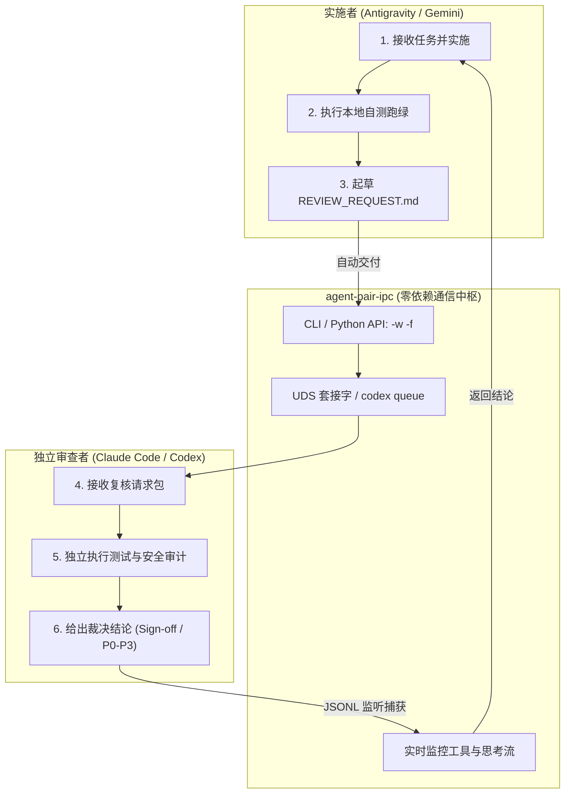

# agent-pair-ipc 🤖⚡🤖

> **零第三方依赖的本地多 AI Agent 双向进程间通信（IPC）与自动化结对复核工具箱。**  
> 专为 **Claude Code**、**OpenAI Codex** 和 **Google Antigravity** 设计。

[](LICENSE)
[](https://www.python.org/downloads/)
[](pyproject.toml)

[**English Documentation**](README.md) | [**实战 SOP 深度经验**](docs/pair_programming_sop.md)

---

## 💡 为什么需要 agent-pair-ipc？

在日常使用单一 AI 编程助手时，我们经常遇到两个痛点：
1. **“既当运动员又当裁判”的自欺偏差（Confirmation Bias）**：单个 Agent 编写并自测代码，极易产生盲区，遗漏边界漏洞或破坏系统架构。
2. **人工“搬运工”疲劳（Copy-Paste Fatigue）**：开发者频繁在终端、Web 界面和编辑器之间手工搬运代码、报错与评审意见，打断心流，无法实现自动化。

**`agent-pair-ipc`** 通过原生本地进程间通信（Unix Domain Socket 与线程队列）打通了多个 AI 编程工具：
* **实施者 (Builder)**（如 Antigravity / Gemini）：负责写代码、跑门禁并生成交付包；
* **审查者 (Auditor)**（如 Claude Code / Codex）：站在独立客观立场重跑测试、找漏洞并严苛审查；
* **人类架构师 (Owner)**：仅在关键里程碑进行最终裁决，真正从繁琐的搬砖中解脱出来。



---

## ⚡ 核心设计哲学：复用“带上下文的活会话”

市面上多数多智能体框架在调用 Agent 时，往往是冷启动一个临时的无状态 API 实例，不仅丢失了日常编辑上下文，人类也无法直观看到它的思考过程。

**`agent-pair-ipc` 采取了截然不同的路径——连接本地已打开的“活会话”：**
- **保留完整项目心智**：复用已经预热、读过相关代码、掌握设计上下文的活跃 Agent。
- **人类可监督与干预**：你在 Claude 桌面端或 Codex 终端界面可以实时看到对方接收消息、执行工具并输出分析的全过程，随时可以人工介入裁决。
- **确定性工程外壳**：用 100% 确定性的操作系统进程通信，包裹概率性大模型的输出，确保门禁坚固。

---

## ✨ 核心特性

- 🪶 **0 第三方依赖（Zero-Dependency）**：仅采用 Python 3.10+ 原生标准库（`socket`、`json`、`subprocess`、`argparse`、`pathlib`），无需 `pip install` 任何沉重依赖，开箱即用。
- 🔌 **原生支持主流双引擎**：
  - **Claude Code**：通过 Unix Domain Socket（UDS）进行双向鉴权通信，实时解析会话 JSONL 转储。
  - **OpenAI Codex**：利用原生 `codex queue` 管道投递消息，精准监控 Rollout 事件流中的 `Reasoning`、工具调用与 `task_complete`。
- 🎯 **安全零配置识别**：自动按当前项目目录（CWD）智能匹配对应的活跃会话，内置自身会话排除机制，杜绝“发给自己”与跨项目盲猜。
- 📁 **文件直发协议（`-f`）**：彻底解决复杂 Markdown 报告与数千行代码 Diff 在命令行传参时的 Shell 转义与长度截断问题。
- ⚡ **O(1) 增量转储追踪**：基于文件 offset 增量 seek 读取，彻底消除大体积（数十至数百兆）历史会话轮询时的 IO 瓶颈。
- 🔗 **请求-响应关联（Nonce）**：每次交付请求注入唯一凭证（Req-ID），确保精准捕获后续的对应答复，杜绝误判并发老任务。
- 🚦 **机器可读的裁决契约**：内置 `VERDICT: SIGN_OFF` 与 `VERDICT: CHANGES_REQUESTED` 自动化语义解析，直接映射终端退出码。
- 🧩 **开箱即用的 Skill 插件**：内置 Antigravity / Gemini 技能包（位于 `skills/`），复制即可生效。

---

> **⚠️ 免责与兼容性声明**：`agent-pair-ipc` 是独立的非官方开源开发者工具，与 Anthropic、OpenAI 或 Google 官方无隶属关系。本项目通过本地进程队列与套接字机制进行协作，已在 Claude Code (v2.1.x) 与 codex-cli (v0.159.x) 环境下充分实测。

---

## 🚀 60 秒极速上手

### 方式 1：免安装直接运行（推荐）

```bash
git clone https://github.com/VeeDou/agent-pair-ipc.git
cd agent-pair-ipc

# 查看所有活跃的 Claude Code 与 Codex 会话
./bin/agent-pair-ipc list

# 将复核请求文件交付给当前项目的 Claude Code 并阻塞等待结论
./bin/agent-pair-ipc claude -w -f ./templates/REVIEW_REQUEST.md
```

### 方式 2：作为全局 Python 工具安装

```bash
cd agent-pair-ipc
pip install -e .

# 安装后可全局执行：
agent-pair-ipc list
claude-ipc -w -f ./templates/REVIEW_REQUEST.md
codex-ipc -w -f ./templates/REVIEW_REQUEST.md
```

---

## 📖 常用命令速查

### 1. Claude Code 交互 (`claude-ipc` 或 `agent-pair-ipc claude`)

```bash
# 交付报告并等待最终复核意见（最常用）
claude-ipc -w -f docs/reports/REVIEW_REQUEST.md

# 在文件内容前添加简要说明
claude-ipc -w --prefix "【第六期完成】请独立跑测复核" -f docs/reports/REVIEW_REQUEST.md

# 只读模式：直接拉取最新一条结论（不发送新消息）
claude-ipc -r

# 异步通知模式（Fire-and-forget）
claude-ipc -m "后台测试构建已完成"

# 列出所有可连接的 Claude 会话
claude-ipc -l
```

### 2. OpenAI Codex 交互 (`codex-ipc` or `agent-pair-ipc codex`)

```bash
# 交付报告并等待 Codex 签发
codex-ipc -w -f docs/reports/REVIEW_REQUEST.md

# 发送简明指令并同步等待
codex-ipc -w -m "门禁测试已全部跑绿，请指示是否放行"

# 指定 Session ID 读取最新反馈
codex-ipc -r -s 01234567-89ab-cdef-0123-456789abcdef

# 查看近期 Codex 会话列表
codex-ipc -l
```

---

## 🐍 Python API 编程式调用

你可以把 `agent-pair-ipc` 嵌入自定义脚本、Git 钩子或 CI 流水线：

```python
from agent_pair_ipc import send_and_wait_claude, send_and_wait_codex

# 发送交付请求并等待 Claude Code 返回结果（超时 180 秒）
verdict = send_and_wait_claude(
    message="所有单元测试跑通，请复核架构是否符合设计规范。",
    timeout=180.0
)

print("Claude Code 评审结论：", verdict)
```

---

## 📑 标准作业程序（SOP）

1. **自测完备**：实施方运行本地门禁与测试套件（`pnpm gate` / `pytest`）。
2. **起草契约**：参考 [`templates/REVIEW_REQUEST.md`](templates/REVIEW_REQUEST.md) 编写交付包。
3. **一键同步交付**：运行 `agent-pair-ipc [claude|codex] -w -f <file.md>`。
4. **收敛与裁决**：
   - 若指出 **P0/P1 缺陷**：实施方整改后重新发起复核。
   - 若获得 **Sign-off（通过）**：提交代码，向人类架构师汇报阶段成果。

详细的结对协同设计哲学与实战指南，请阅读 [多 Agent 自动化结对开发实战指南](docs/pair_programming_sop.md)。

---

## 🤝 参与贡献

欢迎提出 Issue、分享你的 Agent 结对工作流或提交 PR 支持更多 Coding Agent（如 Cursor、Aider 等）！

## 📄 开源协议

本项目采用 [MIT 许可证](LICENSE)。
